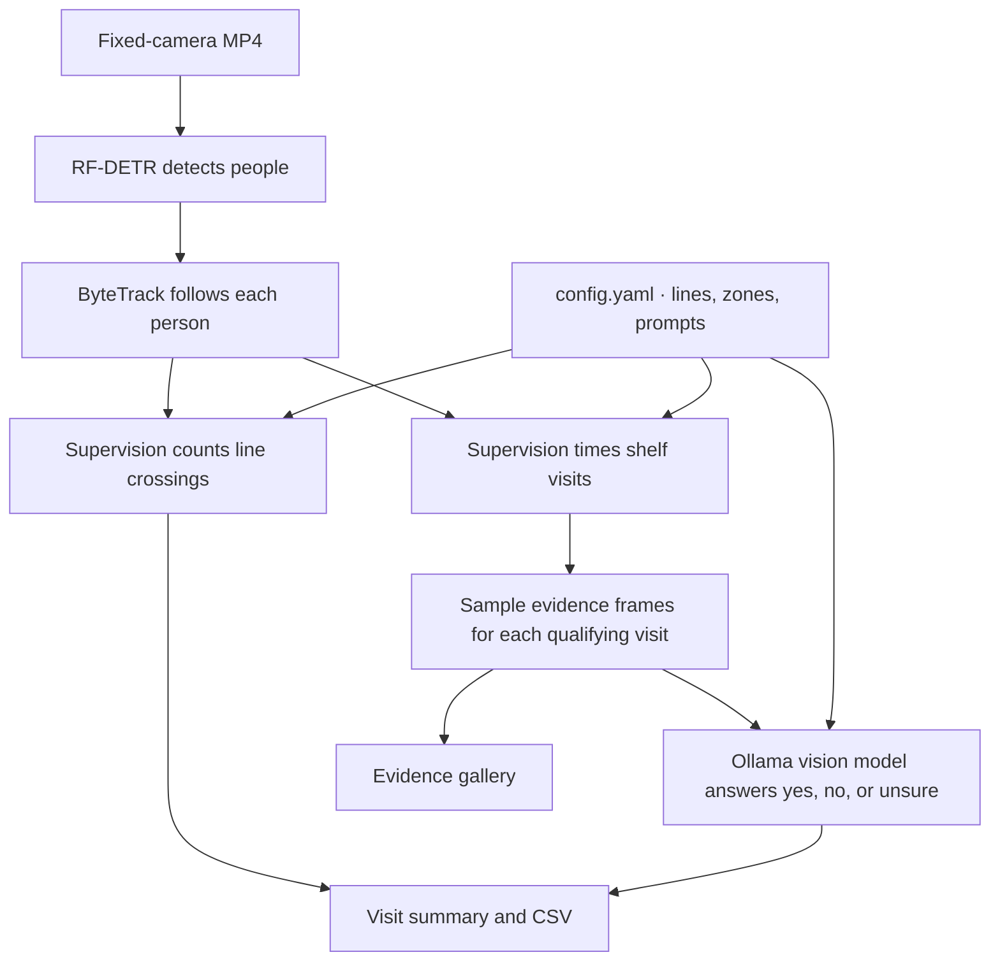

# Panoptes / EdgeEye

**Analyze fixed-camera shop footage locally.** EdgeEye counts people crossing a line, measures how long they spend in shelf zones, and asks a local vision model what happened during each visit. You can review the answers alongside the original evidence frames.

[Quick start](#quick-start) · [Camera calibration](#calibrate-your-camera) · [How it works](#how-it-works) · [Example results](#example-results)

## Quick start

Use Python 3.11 or 3.12. Activate the Python environment you already use for machine learning. From the repository directory, install the project requirements if your environment needs them.

```sh
python -m pip install -r requirements.txt
```

With Ollama installed, start it in a separate terminal if it is not already running. Then download the vision model and launch the web app.

```sh
ollama serve
```

```sh
ollama pull qwen3.5:4b
python app.py
```

Open the local URL printed by Gradio, usually `http://127.0.0.1:7860`. RF-DETR downloads its detector weights on the first analysis.

<details>
<summary>Restart with the project-local Ollama installation</summary>

For a checkout that already has Ollama and the model under `.venv/ollama-runtime`, start the service from the repo in one terminal.

```sh
OLLAMA_MODELS="$PWD/.venv/ollama-runtime/models" .venv/ollama-runtime/bin/ollama serve
```

Start EdgeEye in another terminal.

```sh
.venv/bin/python app.py
```

</details>

## Calibrate your camera

1. **Upload an MP4.** The preview shows the first frame. Click a point to read its original pixel coordinates.
2. **Place the counting line.** In [config.yaml](config.yaml), set the two `entrance_line` endpoints across the doorway. Reverse the endpoints if the count runs in the wrong direction.
3. **Draw the shelf zone.** Under `zones`, list the polygon corners in perimeter order. Put the polygon around the floor where shoppers stand.
4. **Run the analysis.** Re-upload the clip to refresh the overlay, then select **Analyze clip**. Review the visit table and evidence gallery or download the CSV.

The supplied coordinates fit the 1920 × 1080 supermarket clip `10901926`. Its doorway is outside the shot, so `people_in` measures crossings toward the camera in the center aisle. Use a separate config for each camera position and resolution.

## How it works



The default configuration processes every second frame. Supervision uses the bottom center of each tracked box to measure crossings and zone visits. A visit ends after about one second of absence or when the clip ends. Visits shorter than two seconds are filtered out by default. Track IDs are local to the clip, and a returning shopper can generate another visit.

The vision model receives up to four padded image crops per qualifying visit, in time order. Add another question under `checks` to evaluate it against the same frames.

```yaml
  - name: put_back
    zone: shelf_1
    question: Did the shopper pick up a product and then return it to the shelf?
```

## Example results

A run on supermarket clip `10901926` produced the following results.

| Measure | Result |
| --- | ---: |
| Crossings toward the camera | 12 |
| Shelf visits | 4 |
| Model answers for `took_item` | 1 yes · 3 no · 0 unsure |

The model’s yes answer cited a white object in a shopper’s hand. The evidence left the pickup uncertain, so treat prompt answers as model judgments and review the associated frames.

Each completed analysis saves a separate run under `output/`.

| File | Contents |
| --- | --- |
| `summary.json` | Crossing and visit totals, answer counts, and `take_rate_pct`. The rate is the share of all `took_item` answers that were yes, or `null` when there are no answers. |
| `visits.csv` | One row per visit and applicable check, with the start time, duration, track ID, answer, reason, and evidence filename. A zone without checks still records the visit with an empty answer. |
| `visit_001.jpg`, etc. | Evidence frames arranged from earliest to latest. |

To measure accuracy for a camera, compare line counts with a manual count and review at least 30 labeled visits. Record agreement, false yes answers, and the unsure rate.

## Command line

The CLI uses the same pipeline as the web app.

```sh
python run.py path/to/shop.mp4
python run.py path/to/another.mp4 --config camera2.yaml --out results
```

With no video argument, the CLI reads the video path from the YAML file and resolves it relative to that file.

## Project layout

| File | Role |
| --- | --- |
| [`app.py`](app.py) | Gradio upload, camera preview, results table, and gallery |
| [`run.py`](run.py) | Shared analysis pipeline, command-line entry point, and exports |
| [`shopwatch.py`](shopwatch.py) | Detection, tracking, geometry, and evidence sampling |
| [`check.py`](check.py) | Ollama vision prompt and response validation |
| [`config.yaml`](config.yaml) | Camera geometry, sampling settings, and visit questions |

## Verify the pipeline

```sh
python -m unittest discover -s tests -v
```

The suite creates a short MP4 and simulates detections and model replies. It checks ByteTrack, line crossings, repeat visits, evidence sampling, CSV export, and summary counts without downloading model weights.

## Google Colab

Select a GPU runtime, upload the project files into one directory, and use `%cd` to enter it. Install dependencies with `%pip install -r requirements.txt`. Install Ollama in the runtime using its Linux installer, start it with `subprocess.Popen(["ollama", "serve"])`, and run `!ollama pull qwen3.5:4b`.

Use `!python run.py /content/shop.mp4` for the CLI or `!python app.py --share` to create a public browser link. Colab processes uploaded footage in its runtime. Copy completed runs to persistent storage before disconnecting.
